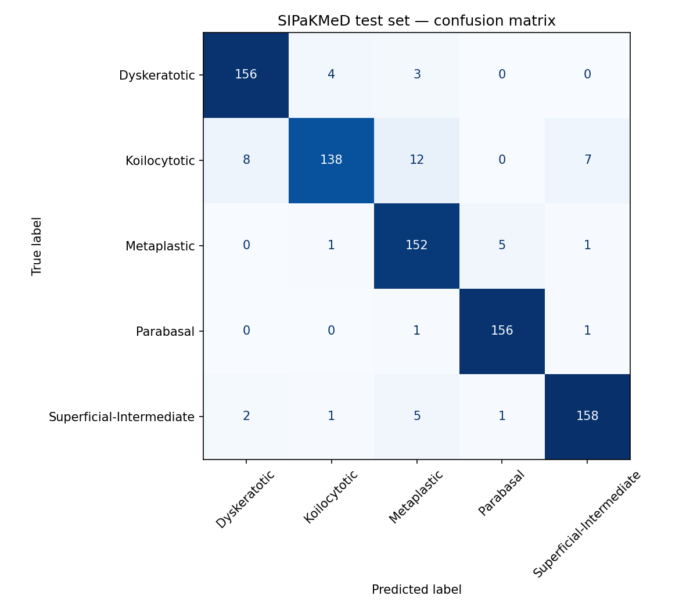
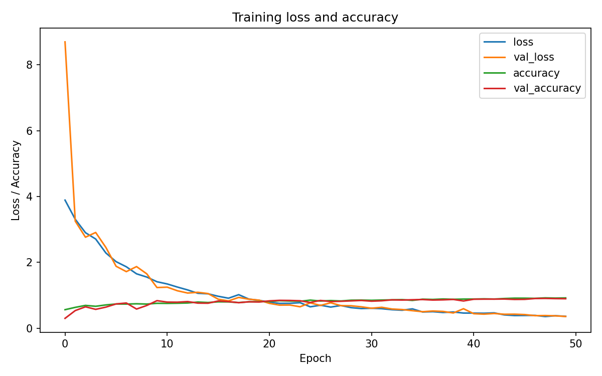

# Cervical Cancer Screening: Pap Smear Classifier

A deep learning project that classifies single-cell Pap smear images from the
[SIPaKMeD dataset](https://www.cs.uoi.gr/~marina/sipakmed.html) into five cell types using a
ResNet built with TensorFlow/Keras.

> This is a research and learning project. It is **not** a medical device and must not be
> used for diagnosis.

## Classes

| Class | Category |
|---|---|
| Dyskeratotic | Abnormal |
| Koilocytotic | Abnormal |
| Metaplastic | Benign |
| Parabasal | Normal |
| Superficial-Intermediate | Normal |

SIPaKMeD contains 4,049 cropped single-cell images across these classes.

## Project structure

```
├── cervnet/
│   ├── config.py        # paths, classes, split ratios, hyperparameters
│   └── resnet.py        # bottleneck ResNet in tf.keras
├── build_dataset.py     # zip/folder -> stratified train / val / test split
├── train_model.py       # train, evaluate, save model + plots
├── predict.py           # classify new images with the trained model
├── output/              # training plot, confusion matrix, report (model file is git-ignored)
└── requirements.txt
```

## Setup

```bash
git clone https://github.com/oyinkansolasj/cervical-cancer-screening-pap-smear-classifier.git
cd cervical-cancer-screening-pap-smear-classifier
python -m venv .venv && source .venv/bin/activate   # Windows: .venv\Scripts\activate
pip install -r requirements.txt
```

## 1. Build the dataset split

Point the script at the SIPaKMeD **zip file** you downloaded (or at an extracted folder):

```bash
python build_dataset.py --dataset path/to/sipakmed.zip
```

The script extracts the zip to `datasets/sipakmed/` and finds the `im_<Class>` folders even
when they are nested. It uses the `CROPPED/` single-cell images and writes a stratified split
to `datasets/split/`: 80% train and 20% test, with 10% of the training images held out for
validation. The `datasets/` folder is git-ignored, so images are never committed.

## 2. Train

```bash
python train_model.py            # 50 epochs by default
python train_model.py --epochs 20
```

Training details:
- Bottleneck ResNet with stages of (3, 4, 6) blocks, 64×64 RGB input, L2 weight decay
- Augmentation with random flips, rotation, zoom and shift, since cells have no fixed orientation
- SGD with momentum and linear (polynomial) learning-rate decay, as in the original tutorial
- Balanced class weights to handle class imbalance
- The checkpoint with the best validation accuracy is saved to `output/cervnet.keras`

Results are written to `output/`:
- `classification_report.txt`: precision, recall and F1 for each class
- `confusion_matrix.png`
- `training_plot.png`: loss and accuracy curves

A GPU is recommended. On CPU, use fewer epochs or run it in Google Colab.

### Train on Google Colab (free GPU)

Training on a laptop CPU can take many hours. To use Colab's free GPU instead (about 10–20
minutes), open `train_on_colab.ipynb` at [colab.research.google.com](https://colab.research.google.com)
via **File → Open notebook → GitHub**, paste this repository's URL, and run the cells in order.

## 3. Predict

```bash
python predict.py path/to/cell1.bmp path/to/cell2.bmp
```

## Results

Trained for 50 epochs on a Google Colab T4 GPU. Evaluated on the 812-image held-out test set
(20% of SIPaKMeD, never seen during training or model selection):

**Test accuracy: 93.6%** (macro F1 0.936)

| Class | Precision | Recall | F1 |
|---|---|---|---|
| Dyskeratotic | 0.940 | 0.957 | 0.948 |
| Koilocytotic | 0.958 | 0.836 | 0.893 |
| Metaplastic | 0.879 | 0.956 | 0.916 |
| Parabasal | 0.963 | 0.987 | 0.975 |
| Superficial-Intermediate | 0.946 | 0.946 | 0.946 |

Parabasal cells are the easiest to classify (98.7% recall). Koilocytotic cells are the hardest:
the model misses 16% of them (83.6% recall). When it does predict Koilocytotic, it is right 95.8%
of the time, so the errors are missed cells rather than false alarms.





## Acknowledgements

- Plissiti, M. E., et al. "SIPaKMeD: A new dataset for feature and image based classification
  of normal and pathological cervical cells in Pap smear images." *IEEE ICIP*, 2018.
- Adrian Rosebrock, PyImageSearch, for the original malaria tutorial this project follows.
